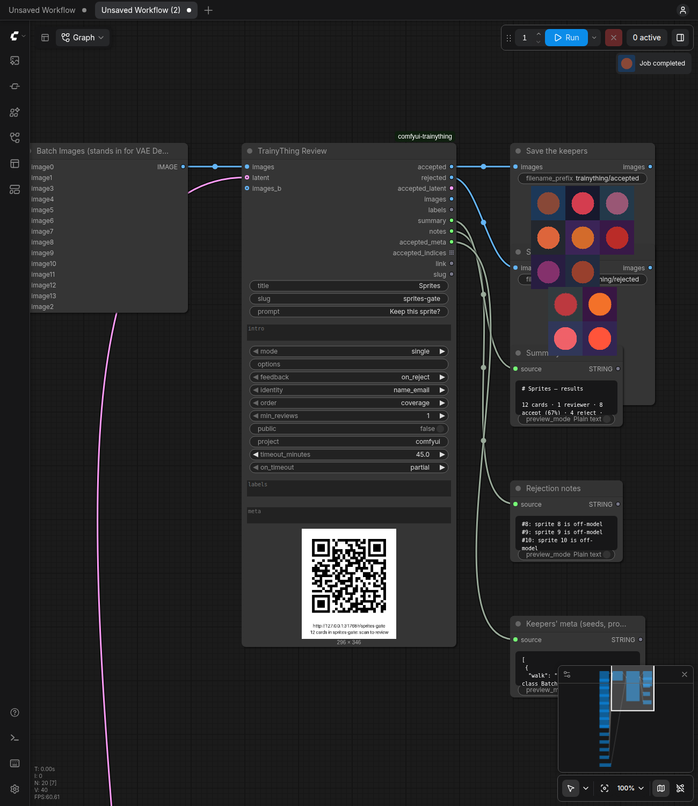

# TrainyThing for ComfyUI

Wire it after VAE Decode, press Queue, and the batch is on your phone as a
TrainyThing review queue: one card per image, swipe to keep or reject, say why.
The keepers, the notes, the seeds and the prompts come back into the graph.

It needs the TrainyThing daemon, which needs Node 22.5 or newer
(`npx -y trainything dashboard` once).

**Status: K3.** Five nodes under *TrainyThing* on the canvas: **Review** (send
the batch, show the link and a QR, wait for the verdicts, pass on the keepers),
**Send** (the first half, for a run that should not wait), **Wait** (the
second half), **Load** (a later run reads a queue back by its slug, images
included) and **Filter** (any batch and its labels, a rule -> the subset).
The full README is K4.



Try it: copy `tests/fixtures/sprites/*.png` into ComfyUI's `input/` folder,
drag `examples/gate.json` onto the canvas, press Run, scan the QR.
`examples/ab-pair.json` is the A/B card, `examples/choose-reasons.json` the
reasons counted.

## The nodes

| Node | Outputs |
|---|---|
| TrainyThing Review | `accepted`, `rejected`, `accepted_latent`, `images`, `labels`, `summary`, `notes`, `accepted_meta`, `accepted_indices` (a list), `link`, `slug` |
| TrainyThing Send | `queue` (only a Wait takes it), `link`, `slug` |
| TrainyThing Wait | as Review, minus `link` and `slug` |
| TrainyThing Load | as Wait, minus `accepted_latent`: `accepted`, `rejected`, `images`, `labels`, `summary`, `notes`, `accepted_meta`, `accepted_indices` |
| TrainyThing Filter | `images`, `latent`, `indices` (a list), `count` (inputs: `images`, `latent`, `images_b`, `labels`, `rule`, `option_id`) |

An empty `accepted` or `rejected` stops only its own branch, silently.
`on_timeout: block` stops everything downstream. Interrupting a waiting node
leaves the queue open. Each finished wait, and each Load, writes
`output/trainything/<slug>/` (`results.json`, `blobs/`, `labels.jsonl`,
`summary.md`, and `preferences.jsonl` in pair mode).

**Modes.** `single` (keep or reject), `pair` (A or B: wire `images_b`, the
same batch size; one card per index with A and B side by side), `choose`
(one answer per card) and `select` (any answers per card); choose and select
need `options`, as `id:Label, id:Label` (`hair:Hair colour, scarf:Scarf,
hands:Hands, ok:Fine`; an id is lowercase letters, digits, `-` and `_`, 2 to
12 options; a malformed list is an error that names the entry). In
`single` and `pair` `options` is ignored, with a console line. `feedback:
on_reject` is sent as `optional` outside single (there is no reject), with a
console line. An empty `intro` quotes the positive prompt and says what to do
in that mode (pair quotes it only when A and B share it).

- **pair:** `accepted` is the chosen image of each pair, from either side,
  in index order; `rejected` the other one. `accepted_indices` and
  `accepted_meta` are the pairs with a winner. `accepted_latent` is
  **blocked** in pair mode (console line): the latent wired is A's, and a
  pair B won has none, so a slice could not line up with `accepted`; VAE
  Encode `accepted` for a latent of the winners. A skipped pair is
  `unjudged`. The run's folder gains `preferences.jsonl` (the DPO shape, one
  line per pair with a winner).
- **choose / select:** there is no yes or no, so `accepted`, `rejected`,
  `accepted_latent`, `accepted_meta` and `accepted_indices` are all blocked,
  silently (the console prints the counts per option). `labels` carries the
  counts (each line's `counts` and `verdict`); `summary` has the table;
  TrainyThing Filter with `rule: option` and an `option_id` gives the images.

**`notes`**, one per line, each prefixed by the card's label (its ref when it
has none); skip notes are never in it. single: the rejection notes. pair:
every note, with the side its reviewer chose (`sprite 03 (chose B): cleaner
outline`). choose / select: grouped by option in the queue's order, tagged
with the ids the reviewer picked (`sprite 01 [hair]: too red`, `sprite 04
[hair, hands]: ...`). **`summary`** is the daemon's `summary.md` as is.

**Load** reads the whole queue: every image card in card order is one image of
the batch (an appended queue's runs one after the other), so `labels` has one
line per image and Filter can slice Load's `images`. `accepted_meta` is what
Send attached to each keeper (its `index` is the position in *its* run, for
Latent From Batch; `accepted_indices` are positions in Load's batch). A
ComfyUI batch has one size, so an image whose size differs from the first
card's is resized to it (bilinear) and the console says how many were. Cards
that are not images (text, audio, video added by the CLI) are skipped with a
console line and are in no output. In pair mode `images` is the A side and
`accepted` / `rejected` take the winning / losing side of each pair. With
`wait` on, Load waits as Wait does (interruptible; at the timeout it loads
what is judged). ComfyUI re-runs Load only when the queue moved: its
fingerprint is the queue's card count, judgment count, status and closed
time (an undo followed by a different verdict leaves the count unchanged; change
the slug field and back, or press Queue after the next verdict). A daemon on
another machine is read through `results/bundle.zip`.

**Filter** reads the `labels` of Wait, Review or Load, one line per image
(line *i* is index *i*; a line that carries its own `index` places itself),
and keeps the indices that match `rule`: `accepted`, `rejected`,
`contested`, `unjudged`, or `option` with `option_id` (choose: the
consensus is that id; select: it includes it; the mode is read from the
lines). A line count that differs from the batch size is an error. An empty
subset blocks `images`, `latent` and `indices` silently; `count` is 0. On
pair labels, wire the B batch to `images_b` too and `accepted` / `rejected`
take the winning / losing image of each pair (the `latent` output is then
blocked: the picks come from both sides); without `images_b` they take the A
side, and `latent` is A's, sliced.

## Where it finds the daemon

The same order as the TrainyThing CLI: `TRAINYTHING_URL` and
`TRAINYTHING_TOKEN` in ComfyUI's environment, then `base_url` / `port` and
`owner_token` in `$TRAINYTHING_HOME/config.json` (default
`~/.trainything/config.json`), then `http://127.0.0.1:4747`. The token is never
a widget, so it never lands in a PNG or a shared workflow.

`TRAINYTHING_FORCE_REMOTE=1` is for tests only: it makes the pack treat even
a daemon on 127.0.0.1 as remote (no auto-start; results through the bundle).

## Layout

| Path | What |
|---|---|
| `__init__.py` | ComfyUI entrypoint (`comfy_entrypoint`, V3 API) |
| `nodes/` | the nodes: `review.py`, `send.py`, `wait.py`, `load.py`, `filter.py`; `inputs.py` (the shared schema); `common.py` (the shared logic, importable without ComfyUI) |
| `examples/` | canvas workflows (drag onto ComfyUI) |
| `trainything_client.py` | the owner API client, standard library only, sync and async |
| `png.py` | IMAGE tensor <-> PNG with Save Image's `prompt` / `workflow` chunks |
| `walk.py` | the graph walk: seed, sampler, prompts, checkpoint, LoRAs |
| `split.py` | labels.jsonl -> accepted / rejected / contested / unjudged / per-option indices; Filter's rules |
| `cards.py` | a batch -> cards; create-or-append by slug |
| `docs/V3-NOTES.md` | what was verified against ComfyUI, with file:line |
| `tests/` | pytest; see `tests/harness/README.md` |

## Tests

```
tests/harness/setup_comfy.sh   # once: CPU ComfyUI + venvs in ~/.cache/comfyui-trainything
tests/run.sh                   # everything, in both venvs
tests/harness/make_examples.py --check --shoot   # rebuild examples/*.json, queue §5.2 through the frontend, the screenshots (headless Chromium)
```

MIT licensed.
