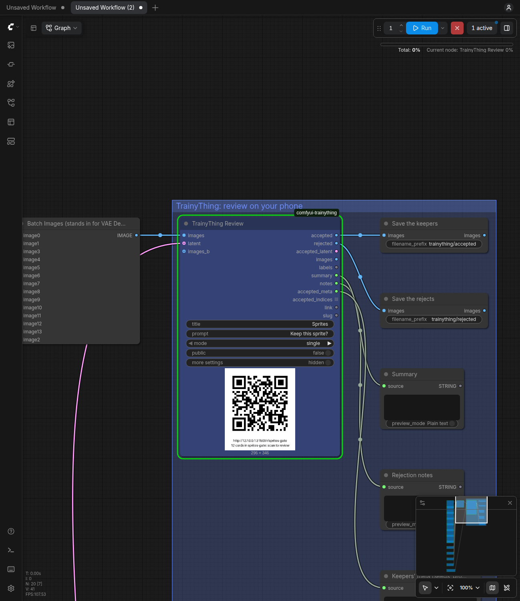

# TrainyThing for ComfyUI



Wire **TrainyThing Review** after VAE Decode and press Queue: the batch becomes
a TrainyThing review queue, the node shows its link and a QR, and the run waits.
Scan it, swipe each image keep or reject on your phone (with a note on why),
and the run goes on with the keepers, the rejects, the notes and each keeper's
seed and prompt on separate sockets. Use it when the choice should be made on a
phone, away from the desk, with a reason attached, or by more than one person.
If you only want to click the keepers on the canvas yourself, keep using an
on-canvas chooser such as cg-image-picker's Image Chooser; it is simpler for
that.

## Install

Clone the pack into ComfyUI's `custom_nodes/`, install its one dependency
with ComfyUI's own python, and restart ComfyUI. **It needs the TrainyThing
daemon, which needs Node ≥ 22.5:** start it once with
`npx -y trainything dashboard` (it keeps running in the background).

```
cd ComfyUI/custom_nodes
git clone https://github.com/ryanrinkel/comfyui-trainything
cd comfyui-trainything
python -m pip install -r requirements.txt     # the python ComfyUI runs with (its venv, or python_embeded\python.exe)
# restart ComfyUI; the five nodes are under "TrainyThing" in the node library
npx -y trainything dashboard                  # once: starts the daemon and opens its dashboard
```

Or from the Comfy Registry, where the pack is `trainything`: search for
TrainyThing in ComfyUI Manager, or `comfy node install trainything`.
ComfyUI Manager's "Install via Git URL" with the repository URL does the
same clone and install.

Try it without a model: copy `tests/fixtures/sprites/*.png` into ComfyUI's
`input/`, drag `examples/gate.json` onto the canvas, press Run, scan the QR.

## Where it finds the daemon

The same order as the TrainyThing CLI, so the CLI, the MCP server and ComfyUI on
one machine agree:

1. `TRAINYTHING_URL` and `TRAINYTHING_TOKEN` in ComfyUI's environment;
2. `base_url` (or `port`) and `owner_token` in `$TRAINYTHING_HOME/config.json`
   (default `~/.trainything/config.json`; the daemon writes it on first start);
3. `http://127.0.0.1:4747`.

**The token is never a widget.** ComfyUI writes every widget value into each
PNG's metadata and into saved and shared workflow files, so a token typed into
a node would leak with the first image posted. The link and slug on the node
are not secrets the daemon relies on. With no daemon at the URL the node fails
with one line: `no TrainyThing at http://127.0.0.1:4747; run
npx -y trainything dashboard once`. ComfyUI on another machine (a rented GPU)
needs `TRAINYTHING_URL` pointing at a daemon it can reach.

When a local daemon does not answer, the node tries once to start it (15 s
budget), with a console line naming how: a `trainything` binary on the PATH
first, else `npx -y trainything list` (the daemon is on npm as `trainything`,
0.1.0 and up). `TRAINYTHING_TOKEN` is passed to that
command only when `TRAINYTHING_URL` is set too; otherwise the CLI reads the
token from `config.json` itself.

During a wait a daemon that stops answering (or answers 5xx) is retried
every 2, 4, 8 … at most 30 seconds until the timeout, with one console line;
a 401, 403, 404 or 409 fails at once.

## The three workflows

All three are in `examples/`, built on Load Image and twelve sprites so they
run with no model (see `examples/README.md`); in a real graph VAE Decode's
output goes where Batch Images is.

**1. The gate: review inside the run** (`examples/gate.json`). Press Queue,
scan the QR, swipe, and the run finishes with the keepers saved and the
rejection notes on screen. The run waits at Review (45 minutes by default,
then it goes on with what was judged).

```
Load Checkpoint ──▶ CLIP Text Encode (+) ──┐
                    CLIP Text Encode (−) ──┤
Empty Latent (batch 12) ───────────────────┴─▶ KSampler ──▶ VAE Decode ──▶ images ─┐
                                                   └──────────────── latent ───────┤
                                                                                   ▼
                                                                     [ TrainyThing Review ]
                                                                     link + QR on the node; the run waits
                                                                        │ accepted ──▶ Upscale ──▶ Save Image
                                                                        │ accepted_latent ──▶ KSampler (denoise 0.35) ──▶ …
                                                                        │ notes ──▶ Show Text
                                                                        └ rejected ──▶ Save Image (prefix "rejected/")
```

**2. Two runs: refine from what was said** (`examples/two-runs-send.json`,
then `examples/two-runs-load.json`). Run 1 sends and ends; queue it several
times with the same slug and the queue on the phone grows. Run 2 reads the
queue back whenever the reviewing is done, images included, even if
ComfyUI's output folder no longer has them. This is the path that never holds
ComfyUI's queue.

```
run 1   … ──▶ VAE Decode ──▶ [ TrainyThing Send  slug: sprites-08 ]        (the run ends; review when convenient)

run 2   [ TrainyThing Load  slug: sprites-08 ] ──▶ images ──▶ [ TrainyThing Filter  accepted ] ──▶ VAE Encode ──▶ KSampler ──▶ …
                                               ├──▶ summary ──▶ Show Text         (rewrite the prompt from the notes)
                                               └──▶ accepted_meta                 (the keepers' seeds and prompts)
```

**3. A and B: which prompt, checkpoint or LoRA** (`examples/ab-pair.json`).
The same seeds through two settings; one card per index with both images on
it; `accepted` is the winner of each pair and the run's folder gains
`preferences.jsonl` (the DPO shape).

```
prompt A ──▶ KSampler (seed 1000) ──▶ VAE Decode ──▶ images   ─┐
prompt B ──▶ KSampler (seed 1000) ──▶ VAE Decode ──▶ images_b ─┴─▶ [ TrainyThing Review  mode: pair ] ──▶ accepted (the winners)
                                                                        output/trainything/<slug>/preferences.jsonl
```

## The nodes

All five are under **TrainyThing** in the node library.

### TrainyThing Review

Send, then Wait, in one node; the batch and its latent stay in memory across
the wait. An output node: it runs with nothing wired downstream.

A fresh node shows the essentials: `images`, `title`, `prompt`, `mode`,
`public`. The rest sits behind a **more settings** switch on the node
(`web/trainything.js`; the frontend's own *Show advanced inputs* in its
Vue node renderer), and unfolds by itself when a loaded workflow changed
one of them. The five nodes come coloured so the review part of a graph
reads as one box; a colour you pick on the node wins.

| Input | Default | What it does |
|---|---|---|
| `images` | | IMAGE, any batch size: one card per image |
| `latent` (optional) | | LATENT of the same batch: `accepted_latent` is sliced from it |
| `title` | `ComfyUI batch` | the queue's title on the phone and the dashboard |
| `prompt` | `Keep this one?` | the question on every card |
| `mode` | `single` | `single`, `pair`, `choose`, `select` (see Modes) |
| `public` | off | start the tunnel now (before any upload), so the link works off this machine; if the tunnel fails, the console says so and the link is the local one |
| `slug` (more settings, from here down) | empty | the link name. Empty: from the title. An open queue's name: the cards are **appended** (see below). A closed queue's name: an error. `random`: an unguessable one |
| `intro` | empty | shown before the first card. Empty: "Generated from: *the positive prompt*." and what to do in this mode |
| `options` | empty | `choose` / `select` only, required there: `id:Label, id:Label, …` |
| `feedback` | `on_reject` | when the reviewer is asked why: `on_reject`, `optional`, `off`, `required` |
| `identity` | `name_email` | reviewers give a name and email, or `anonymous` |
| `order` | `coverage` | `coverage` (cards with fewest reviews first) or `fixed` (batch order) |
| `min_reviews` | 1 | reviews per card before the queue is done (1 to 50) |
| `project` | `comfyui` | the project tag on the dashboard |
| `timeout_minutes` | 45 | stop waiting after this long (≥ 0.1); the queue stays open |
| `on_timeout` | `partial` | `partial`: go on with what was judged, the rest `unjudged`. `block`: nothing downstream runs |
| `images_b` (optional) | | `pair` mode: the B side, same batch size |
| `labels` (optional) | empty | one line per image, shown above its card |
| `meta` (optional) | empty | one JSON object for all images, or one per image (JSON lines or an array); merged over what the graph walk found, and it wins |

Hidden: the node's id, the prompt graph and the workflow, which go into each
PNG's `prompt` / `workflow` chunks and feed the graph walk. Under ComfyUI's
`--disable-metadata` the PNGs carry neither chunk, as Save Image's; the walk
still fills `meta`.

**Appending to a queue the node did not make.** A queue made by the CLI, the
dashboard or the MCP server keeps its own settings, checked before anything
is uploaded: a `mode` other than the queue's is an error naming both; other
`options` give way to the queue's (a console line says so); a queue with no
`min_reviews` gets the node's (without one the wait could only end on a close
or the timeout), and a queue with its own keeps it (a console line when it
differs from the widget).

The checks the split needs run before anything is uploaded or waited on:
`pair` needs `images_b` of the same batch size, and a wired `latent` needs at
least as many samples as `images`.

| Output | Type | What it holds |
|---|---|---|
| `accepted` | IMAGE | the keepers, in batch order |
| `rejected` | IMAGE | the rejects |
| `accepted_latent` | LATENT | the keepers' latents, when `latent` was wired |
| `images` | IMAGE | the whole batch |
| `labels` | STRING | `labels.jsonl` for this run: one line per image with `ref`, `label`, `verdict`, the tallies, `contested`, `notes` |
| `summary` | STRING | the daemon's `summary.md`: counts, then notes grouped by verdict |
| `notes` | STRING | the notes, one per line, prefixed by the card's label |
| `accepted_meta` | STRING | a JSON array of the keepers' `meta`: `index`, `position`, `run`, `seed`, `steps`, `cfg`, `sampler`, `scheduler`, `denoise`, `prompt_text`, `negative_text`, `checkpoint`, `loras`, `batch_size`, `width`, `height`, `walk`, plus your `meta` |
| `accepted_indices` | INT list | the keepers' batch indices; a node downstream runs once per keeper |
| `link` | STRING | the review link (the tunnel's when `public` is on) |
| `slug` | STRING | the queue's name |

An empty `accepted` or `rejected` stops only its own branch: Save Image after
`rejected` simply does not run when nothing was rejected.

### TrainyThing Send

Review's first half: makes (or appends to) the queue, shows the link and QR,
and the run goes on. An output node.

Inputs: Review's, without `latent`, `timeout_minutes` and `on_timeout`.

| Output | Type | What it holds |
|---|---|---|
| `queue` | TRAINYTHING_QUEUE | a handle (URL, slug, queue id, link, this run's card refs); only TrainyThing Wait takes it |
| `link` | STRING | the review link |
| `slug` | STRING | the queue's name |

### TrainyThing Wait

Review's second half, for when Send and the split sit in different parts of
the graph.

| Input | Default | What it does |
|---|---|---|
| `queue` | | from TrainyThing Send |
| `images` | | the batch Send was given, to slice |
| `latent` (optional) | | its latent, for `accepted_latent` |
| `images_b` (optional) | | `pair` mode: the B batch, so winners can come from either side |
| `timeout_minutes` | 45 | as Review |
| `on_timeout` | `partial` | as Review |

`pair` mode without `images_b` (or with another batch size), or a latent with
fewer samples than `images`, is an error at once, before the wait.

Outputs: Review's first nine (`accepted` … `accepted_indices`), not `link` or
`slug`. Only this run's cards are split, even in an appended queue.

### TrainyThing Load

A later run reads a queue back by name, images from the daemon's blob store.

| Input | Default | What it does |
|---|---|---|
| `slug` | empty | the queue's link name (as on the dashboard), or its id |
| `wait` | off | off: read what is judged now. On: wait until the queue is done or the timeout, as Wait does |
| `timeout_minutes` | 45 | with `wait` on: stop waiting and load what is judged |

| Output | Type | What it holds |
|---|---|---|
| `accepted`, `rejected`, `images` | IMAGE | as Review; `images` is every image card in card order (an appended queue's runs one after another) |
| `labels`, `summary`, `notes` | STRING | as Review, for the whole queue |
| `accepted_meta` | STRING | as Review. `position` is the keeper's position in Load's batch (the same numbers as `accepted_indices`); `index` is its index in the batch its own Send was given (the sampler's), for Latent From Batch. With several runs in the queue they differ. A card that Send did not make has no `index` |
| `accepted_indices` | INT list | positions in Load's batch |

No `accepted_latent`: a latent is not stored. Cards that are not images
(text, audio, video added by the CLI) are skipped with a console line. ComfyUI
re-runs Load only when the queue moved (cards, judgments, status, closed time,
last activity).

### TrainyThing Filter

Any batch, the labels, a rule: the subset. It does not talk to the daemon.

| Input | Default | What it does |
|---|---|---|
| `images` | | the batch the labels describe, one line per image |
| `latent` (optional) | | its latent, sliced the same way |
| `images_b` (optional) | | `pair` labels: the B batch, so `accepted` / `rejected` take the winning / losing image of each pair (not wired: the A side) |
| `labels` | | from Review, Wait or Load (a socket, not a text box) |
| `rule` | `accepted` | `accepted`, `rejected`, `contested`, `unjudged`, `option` |
| `option_id` | empty | with `option`: `choose`, the consensus is this id; `select`, it includes it |

| Output | Type | What it holds |
|---|---|---|
| `images` | IMAGE | the subset, in batch order |
| `latent` | LATENT | its latent (blocked when the picks come from both pair sides) |
| `indices` | INT list | the subset's indices |
| `count` | INT | how many (0 when empty; the other three are then blocked) |

A labels line count that differs from the batch size is an error.

## Modes

| Mode | The card | `accepted` / `rejected` |
|---|---|---|
| `single` | one image; keep or reject | the keepers / the rejects |
| `pair` | `images` (A) and `images_b` (B) side by side; pick one | the chosen image of each pair, from either side / the other one. `accepted_latent` is blocked (the wired latent is A's) |
| `choose` | one image; pick one of the `options` | both blocked; `labels` and `summary` carry the counts; Filter `option` gives the images |
| `select` | one image; pick any of the `options` | as `choose` |

`options` is `id:Label, id:Label, …`, for example `hair:Hair colour,
scarf:Scarf, hands:Hands, ok:Fine`. An id is lowercase letters, digits, `-`
and `_`; 2 to 12 options; a malformed list is an error that names the entry.
It is ignored (with a console line) in `single` and `pair`. In `choose` and
`select`, `accepted_meta` and `accepted_indices` are blocked too.

A card is **contested** when reviewers tie (with `min_reviews` above 1) and
**unjudged** when nobody judged it, or it was skipped; such cards are in
neither set and Filter reaches them by rule. `notes`: single, the rejection
notes; pair, every note with the side chosen (`sprite 03 (chose B): cleaner
outline`); choose / select, grouped by option (`sprite 04 [hair, hands]: …`).

## Recipes

| To refine… | Wire |
|---|---|
| Keep only the keepers | `accepted` → Save Image |
| The keepers, bigger | `accepted` → Upscale → KSampler img2img, or `accepted_latent` → KSampler at low denoise |
| One keeper, exactly again | drag its PNG from `output/trainything/<slug>/blobs/` onto the canvas: the workflow is inside it. Or `seed` + `batch_size` + `index` from `accepted_meta` with core's Latent From Batch |
| The prompt | `summary` (or `notes`) → a text preview; read the notes beside the prompt and change it |
| The reasons, counted | `mode: choose` with reason tags as options → the counts in `summary`; Filter `option hair` → those images |
| Defects, tagged | `mode: select` with the same tags; Filter `option` takes every card that includes one |
| Two of anything | `images_b`, `mode: pair`, same seeds → `preferences.jsonl` |
| A dataset of keepers with captions | `python examples/dataset.py ComfyUI/output/trainything/<slug>` → `<ref>.png` + `<ref>.txt` pairs (caption: `meta.prompt_text`), the LoRA-trainer convention. `--rule rejected` or `--rule option:<id>`; `--out DIR`. Standard library only |
| Several opinions | `min_reviews: 2` and `public` on; contested cards stay out of both sets and are yours to decide |

## What the run leaves on disk

Each finished wait (Review, Wait) and each Load writes
`ComfyUI/output/trainything/<slug>/` (the files are overwritten each time):

| File | What |
|---|---|
| `results.json` | the whole queue: every card, its items, `meta`, judgments and summary |
| `blobs/` | every image as the PNG that was uploaded, with the `prompt` and `workflow` chunks Save Image writes (none under `--disable-metadata`) |
| `labels.jsonl` | one line per card: `ref`, `label`, `verdict`, tallies, `contested`, `notes` |
| `summary.md` | counts and notes grouped by verdict, written to be read |
| `preferences.jsonl` | `pair` mode only: one line per pair with a winner |

The queue itself lives in the daemon (`~/.trainything`), so Load can read it
back after this folder is gone.

## Known limits

- **A waiting node holds ComfyUI's whole queue**, like every on-canvas
  chooser. Nothing else runs until the reviewing is done, the timeout passes
  or you press Cancel (the queue stays open; Load reads it later). Send, then
  Load, never holds it.
- **ComfyUI caches an unchanged Send or Review**: queueing the same graph
  with the same inputs skips it, since those images are already on the phone.
  Change a seed or a widget to send again.
- **`accepted_latent` is always blocked in `pair` mode**: the wired latent is
  A's and a pair B won has none. VAE Encode `accepted` for the winners' latent.
- **Load re-reads on a reviewer's visit.** Load's cache key carries the
  queue's last activity, so an undo followed by another verdict re-runs it;
  that time also moves when a reviewer merely opens a card, which costs one
  re-read and nothing else.
- **The run's folder is best effort after a wait.** A full or read-only
  output folder, or a failed bundle, is one console line; the split is
  returned anyway and Load reads the queue later. A daemon that answers
  `results?out=` from another filesystem (Docker on 127.0.0.1) is noticed
  (no fresh `results.json` here) and the bundle is read instead.
- **`public` needs cloudflared.** The daemon fetches it on first use; where
  that fails, install `cloudflared` on the PATH. Without `public` the link
  only works on this machine (or your LAN, if the daemon is bound to it).
- **The graph walk is best effort.** It follows `images` back through VAE
  Decode, KSampler, the text encoders and LoRA loaders to the checkpoint, and
  writes where it stopped in `meta.walk`. Custom samplers, loop packs and
  seed-per-image setups stop it; the `meta` input overrides anything it got
  wrong, and the PNG carries the whole workflow regardless.
- **Mixed sizes are resized.** A ComfyUI batch has one size, so Load resizes
  any image whose size differs from the first card's (bilinear), and a B
  batch of another size is resized to A's; the console says how many.
- `ui.PreviewText` does not render on custom nodes in ComfyUI 0.39.0, so the
  link is printed under the QR in the image (and on the console).
- Built and tested against ComfyUI 0.39.0 (`requires-comfyui = ">=0.39.0"`);
  an older ComfyUI prints one warning line at startup and may not load the
  nodes. Images only for now; audio and video are later.

## Development

```
tests/harness/setup_comfy.sh   # once: CPU ComfyUI 0.39.0 + two venvs in ~/.cache/comfyui-trainything
tests/run.sh                   # the whole suite in the harness venv, then in a bare venv (Pillow + numpy)
tests/harness/make_examples.py --check --shoot   # rebuild examples/*.json through the frontend, check them, re-take the screenshots
```

The tests start throwaway daemons (from `../trainything`, `TRAINYTHING_REPO`;
it needs `pnpm build`) and throwaway CPU ComfyUIs on random ports, judge
through the reviewer API, and never touch `~/.trainything` or port 4747.
`tests/test_k4_install.py` is the stranger install: a fresh ComfyUI checkout,
this repo `git clone`d into its `custom_nodes/`, the five nodes in
`/object_info`. `TRAINYTHING_FORCE_REMOTE=1` is for tests only (a local
daemon treated as remote).

| Path | What |
|---|---|
| `__init__.py` | the entrypoint (`comfy_entrypoint`, V3 API) and the ComfyUI version check |
| `nodes/` | the five nodes; `inputs.py` the shared schema; `common.py` the shared logic, importable without ComfyUI |
| `trainything_client.py` | the owner API client, standard library only |
| `png.py`, `walk.py`, `split.py`, `cards.py` | PNG chunks; the graph walk; labels → indices; a batch → cards |
| `examples/` | the canvas workflows and `dataset.py` |

## License

MIT; see `LICENSE`.
